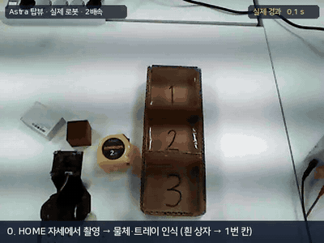
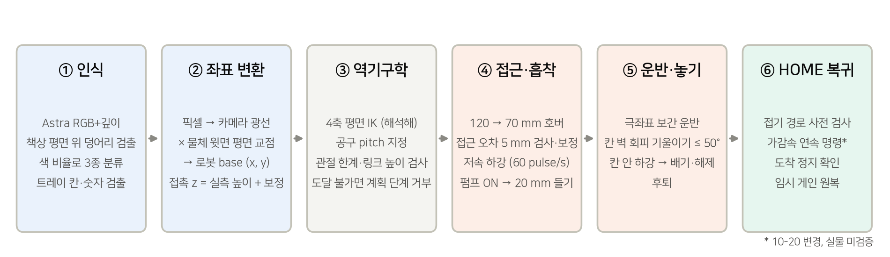
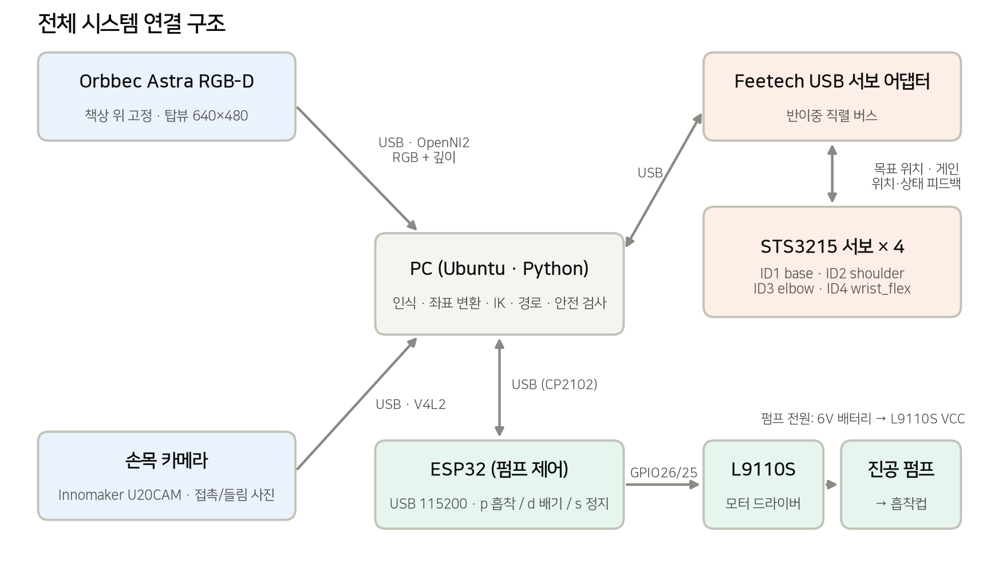
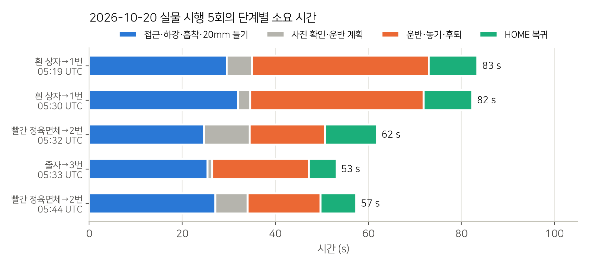

# 4축 진공흡착 로봇팔의 비전 기반 Pick & Place 시스템 구현

4축 로봇팔과 진공흡착 장치를 활용해 물체를 인식하고 트레이의 지정된 칸으로 옮기는 시스템을 구현했습니다. RGB-D 카메라의 관측값을 로봇 좌표로 변환하고, 역기구학으로 관절 목표를 계산하여 집기·운반·놓기·HOME 복귀를 연결했습니다.

<p align="center">
  <br>
  <sub>실제 로봇 한 사이클: 흰 상자 → 1번 칸 (Astra 탑뷰, 4배속) · 자막이 있는 2배속 영상: <a href="portfolio/media/demo_pick_place_2x.mp4">demo_pick_place_2x.mp4</a></sub>
</p>

| 항목 | 내용 |
|---|---|
| 로봇 | SO-101 계열 4축 팔 (base · shoulder · elbow · wrist_flex), Feetech STS3215 서보 4개 |
| 그리퍼 | 스프링 흡착컵 + 진공 펌프 (ESP32 + L9110S로 구동) |
| 센서 | Orbbec Astra RGB-D (탑뷰, 고정), Innomaker U20CAM 손목 카메라 |
| 소프트웨어 | Python 3.12, OpenCV, NumPy, OpenNI2 (ROS 없이 직접 서보 버스 제어) |
| 대상 물체 | 빨간 정육면체(40 mm), 흰 상자(24 mm), 줄자(30 mm) → 3칸 트레이 |
| 상세 설명서 | [portfolio/4축_진공흡착_로봇팔_PickPlace_포트폴리오.pdf](portfolio/4축_진공흡착_로봇팔_PickPlace_포트폴리오.pdf) |

## 동작 흐름



1. **인식**: HOME 자세에서 Astra로 촬영합니다. 깊이로 책상 평면을 맞춘 뒤 평면 위로 솟은 덩어리를 찾고, 색 비율로 물체 3종을 구분합니다. 트레이는 벽 깊이와 손글씨 숫자(1·2·3)로 칸 위치와 번호를 구합니다.
2. **좌표 변환**: 물체 윗면 중심 픽셀을 카메라 광선으로 바꾸고, 물체 윗면 높이의 평면과 만나는 점을 로봇 base 좌표로 씁니다. 접촉 높이는 자로 잰 물체 높이에 흡착컵 보정값을 더해 정합니다. 깊이 측정은 ±3 mm 오차가 있어 높이에는 쓰지 않습니다.
3. **역기구학**: 공구 pitch를 정해 4축 평면 IK를 해석적으로 풉니다. 관절 한계와 링크 높이(책상 충돌)를 먼저 검사하고, 도달할 수 없는 목표는 계획 단계에서 거부합니다.
4. **접근·흡착**: 120 mm와 70 mm 높이에서 차례로 멈춰 접근 오차를 5 mm 기준으로 검사·보정합니다. 이어서 60 pulse/s로 천천히 내려가 흡착하고 20 mm 들어 올립니다.
5. **운반·놓기**: base 기준 극좌표로 보간해 칸 위로 옮깁니다. 칸 벽에 닿지 않도록 필요하면 공구를 최대 50°까지 기울이고, 칸 안으로 내린 뒤 배기해 놓습니다.
6. **HOME 복귀**: 복귀 경로 전체를 명령 전에 검사한 뒤 접어서 복귀합니다. 도착 후 정지를 확인하고 임시 게인을 원래 값으로 돌립니다.

## 시스템 구성



| 신호 | ESP32 | 연결처 |
|---|---|---|
| 펌프 방향 A | GPIO26 | L9110S A-1A |
| 펌프 방향 B | GPIO25 | L9110S A-1B |
| UART RX (배선만, 미사용) | GPIO33 | 서보 어댑터 TX |
| UART TX (배선만, 미사용) | GPIO32 | 서보 어댑터 RX |
| 공통 GND | GND | (−) 레일 |

PC는 USB 115200 baud로 펌프를 제어합니다(`p` 흡착 / `d` 배기 300 ms / `s` 정지 / `q` 식별). 배선도와 펌웨어는 [`하드웨어 설명/`](하드웨어%20설명/README.md)에 있습니다.

## 주요 문제 해결

| 문제 | 원인 | 수정 | 검증 |
|---|---|---|---|
| 먼 위치일수록 옆으로 최대 16.5 mm 어긋난 집기 | 카메라 좌표와 팔 모델의 위치별 오차 | 카메라 이동 후 팔 FK를 자 삼아 8점으로 카메라 자세 재보정, 팔 영점 보정 | 맞춤 RMS 3.0 mm, 교차검증 RMS 6.2 mm, 기구학 잔차 5.97 → 1.28 mm |
| 카메라 재보정 뒤 옛 위치 보정이 중복 적용됨 | 옛 카메라 오차를 메우던 앵커 오프셋·접선 보정이 남음 | 좌표 계산을 자세 추정·평면 투영·경험 보정으로 나누고, 옛 보정 두 가지를 0으로 끔(원래 값 보관) | 재보정 후 상자 중앙 접촉 확인 |
| 운반 중 팔 떨림 | base 임시 게인 P32, 직선 경로에서 base 저속 stick-slip | base P16 복원, 극좌표 보간으로 base를 일정 속도로 회전 | 실물에서 떨림 해소 확인 |
| 정지했는데 다음 동작 인계가 거부됨 | 하중으로 남는 3–6 pulse 편차를 움직임으로 오판 | 목표 불변·위치 안정·편차 크기를 따로 검사하고 관절별 하중 오프셋으로 기록 | 모의 시험 통과, 실물 효과 미확인 |
| 트레이 칸 위치 오인·인식 실패 (물체가 벽에 걸림, 칸이 가려짐) | 깊이에 벽 일부만 보여 방향이 12° 틀어짐, 물체가 칸 바닥을 가림 | 색 실루엣으로 긴 축 추정, 빈 트레이 기준 프레임 저장 후 모서리 정합으로 이동·회전 보정(40 px·6° 넘으면 재인식) | 정육면체 → 2번 칸 실물 성공, 실제 프레임 9 px·−1.3° 이동을 잔차 0.3 px로 측정 |
| 수직 자세로 닿지 않는 위치, 중간 경로 실행 불가 | 4축 팔의 자세 제약 | 접근·호버·접촉을 같은 IK로 검사, 기울기 0–20° 탐색, 벽·주변 물체 높이로 운반 경로 구성 | 45° 기울여 1번 칸에 놓기 실물 사용 |

## 검증 결과 (실측값만)



- 2026-10-20 시행 5회(흰 상자 2, 빨간 정육면체 2, 줄자 1): 실행 기록상 집기→놓기 사이클 완료 5/5, 해제 명령 5/5, 자동 HOME 복귀 5/5.
- 한 사이클은 53–83 s입니다. 접근·흡착·들기 25–32 s, 놓기 16–38 s, HOME 복귀 6–11 s가 걸렸습니다. 흰 상자는 1번 칸 벽을 피하려고 기울이는 단계가 있어 가장 깁니다.

## 한계

- 압력 센서가 없어 흡착을 직접 확인하지 못합니다. 손목 사진 판정은 한 조명·한 책상에서 맞춘 잠정 기준입니다.
- 색 기반 분류라 밝은 무채색 물체는 흰 상자와 구분하지 못합니다. 숫자 인식은 지금 필체에서만 확인했습니다.
- 집기 가능한 반경은 약 0.16–0.30 m입니다. 이 범위 밖은 계획 단계에서 거부합니다.

## 실행

```bash
cd 4dof_ik
python scripts/sort_menu.py          # 번호 메뉴: 물체 분류기 (1~5 물체 넣기, 6 HOME 복귀, 7 새 물체 자동 집기)
python scripts/plan_sort.py --command "빨간 상자 3번 칸에 넣어줘"   # 카메라만 읽고 계획 출력
python scripts/run_sort.py --execute --supported --object red_cube  # 실제 구동 (재시도 포함)
```

`--execute --supported` 없이 실행하면 로봇을 움직이지 않고 계획만 출력합니다. 개발 환경은 conda `lerobot_312`(Python 3.12)입니다.

## 폴더 구조

```
scripts/      메뉴, 계획, 집기·놓기 실행, 새 물체(unknown) 집기, HOME 복귀, 보정 도구
src/camera    Astra 촬영, 카메라 보정, 손목 영상
src/perception 물체 분류, 집기 목표, 위치 보정
src/tray      트레이·칸·숫자 검출
src/robot     좌표계, 4축 IK
src/hardware  서보 버스, 관절 매핑, 궤적 검증, 진공 펌프
src/motion    접근·복귀, 정지·집힘 확인, 게인
src/sorting   운반·놓기 계획과 실행
tests/        새 물체 인식·칸 맞춤·계획 연결 시험
하드웨어 설명/  배선도, 핀 명세, ESP32 펌웨어, 진공흡착팔 CAD(STEP)
portfolio/    설명서 PDF, 그림, 동작 영상
```

> 진공흡착팔 CAD(`SO101 Assembl v4.stp`, `Wrist_Roll_Pitch_SO100 v16.stp`)는 공개된 SO-101 진공흡착 개조 설계 "Braccio per SO-101 con ventosa"를 받아 쓴 것입니다. 라이선스를 확인하지 않아 원본 파일은 저장소에 넣지 않았고, 렌더링 이미지만 포함했습니다. OpenNI2 드라이버(`calibration/openni2_redist/`)도 같은 이유로 제외했으니 Orbbec OpenNI2 SDK에서 받아 그 위치에 두세요.
